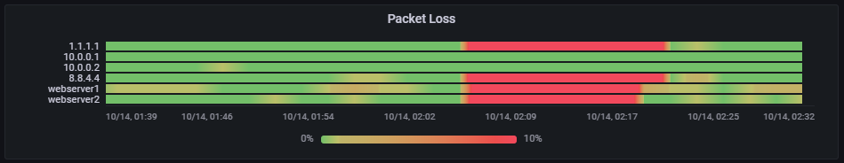

# Hotchart panel

Hotchart is a Grafana panel that displays one row per numeric time series. Each row is a continuous color band over time. Values are linearly interpolated between samples, then mapped to a gradient. Null samples fade to zero opacity.

## Build

This repository uses pnpm. Run `pnpm install`, `pnpm run typecheck`, `pnpm test`, and `pnpm run build`. The distributable plugin is in `dist/`.

The plugin is built against Grafana 8.4.5. For local development, copy `dist/` into a Grafana plugin directory named `local-hotchart-panel`, set `GF_PLUGINS_ALLOW_LOADING_UNSIGNED_PLUGINS=local-hotchart-panel`, and restart Grafana. The plugin is unsigned and must be signed before publication.

## Query data

Use a query that returns a time field and one or more numeric fields. Each numeric field becomes a row. A table with one time field, one string metric field (such as IP), and one numeric value field is also supported; each distinct string becomes a row. For values between samples, the panel interpolates linearly. No time bucketing or aggregation is applied. Duplicate timestamps use the last sample in the query result.

Grafana's Thresholds editor controls the default gradient. Add a Base color and any number of threshold colors, then choose Absolute or Percentage mode. Hotchart interpolates in HSL between those stops. For the packet loss example, use a green Base, `0.0001` tan, and `0.1` red; with Grafana's `percentunit`, those values display as 0%, 0.01%, and 10%. The gradient uses one shared set of stops from the first metric field. Choose Manual HSL in the panel options to use low and high HSL colors instead.

The panel options also control the shared scale minimum and maximum, row height, and label width. Leave the scale bounds empty to use the data range, or the last absolute threshold when field thresholds are enabled.

The default row height is 12 pixels so a panel can show many metric rows, such as a packet loss chart with one IP address per row. Increase it for fewer metrics or more space between rows.

Drag across the plot to select a time interval and zoom the Grafana dashboard to that range. A short click does not change the range.
